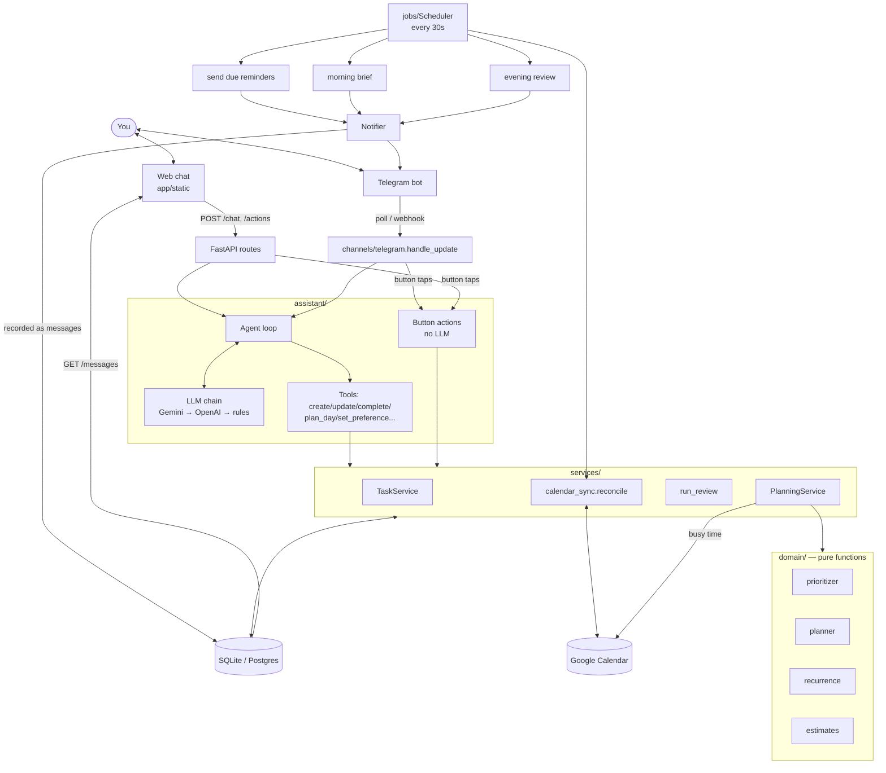

# Architecture

## Design principles

1. **The LLM understands, the code decides.** The model turns "finish the report by friday, urgent" into a tool call. Ranking,
   free-time arithmetic and scheduling are deterministic Python (`app/domain`), so plans are predictable, explainable and testable.
2. **One process, one database.** Reminders are rows in the database and a loop sends whatever is due. No broker, nothing to lose on restart.
3. **It talks first.** A personal assistant that only answers is a chatbot. The scheduler sends the morning brief, block reminders and the evening review.
4. **Degrade, don't die.** LLM down → rule-based fallback. Google down → plan without it, sync later. Telegram down → retry with backoff. Every external dependency can fail without taking the assistant with it.

## How the parts connect

The web UI never has a private channel to the assistant: everything the assistant says (replies and proactive messages) is a row in
`messages`, and the page simply shows that table. Telegram gets the same messages pushed.

## A message, end to end

1. `POST /api/v1/chat` (or a Telegram message) → `Assistant.handle` stores it and builds the prompt: current local time, working hours, your open tasks, the last 24 messages.
2. The LLM answers with text or **tool calls**. Each tool (`assistant/tools.py`) validates its arguments, calls a service, and returns `{"ok": ..., "message": ...}`.
   Errors the user can fix (`"I couldn't find a task matching…"`) go back to the model so it can ask a better question; crashes are logged and replaced with a generic error.
3. The loop repeats (max 6 steps) until the model replies in text. Tools that produce a draft plan attach an **Approve** button.
4. Anything touching the calendar triggers a background `reconcile`.

## Planning

`PlanningService.build` gathers open TASKs, applies learned estimate factors, collects busy time (events in the DB + Google Calendar), and calls `domain.planner.plan_day`:

* free time = working hours − busy − blocked windows (lunch…) − (for today) the past
* tasks in score order (priority + deadline urgency + overdue + quick-win + age); long tasks are cut into even blocks ≤ `max_block_min`
* P1/P2 prefer the focus window; P3/P4 prefer the rest; a buffer follows every block; blocks end before their deadline
* what doesn't fit is **deferred with a reason**, never silently dropped
* `commit` replaces not-yet-finished blocks for that day and creates `BLOCK_START` / `BLOCK_END` reminders

## Reliability decisions

| Concern | Decision |
|---|---|
| Restart loses reminders | Reminders are DB rows. On restart overdue ones are sent late, or expired if stale (a "start now" nudge an hour late is noise) |
| Double sends | Each reminder is committed right after sending (a crash can at worst resend one) |
| Telegram/Google outage | Delivery retried with exponential backoff (≤ 8 tries); calendar writes are retried on the next run because blocks carry `updated_at`/`synced_at` |
| LLM outage / bad output | Failover chain ending in an offline rule-based parser; a tool loop is capped; the model never touches the DB directly |
| Time zones | Everything stored as UTC (`UTCDateTime` rejects naive datetimes and fixes SQLite's tz stripping); recurrence keeps local wall-clock time across DST |
| Secrets | Google tokens encrypted at rest, never returned; OAuth `state` is signed and expires; Telegram only serves one allow-listed chat; webhook needs a secret; production refuses to start without `API_KEY`/`SECRET_KEY` |
| Concurrency | One conversation lock so two messages never interleave; SQLite in WAL mode with a busy timeout |

## Extending

* **New channel** (WhatsApp, Slack…): implement `send(text, buttons)` + feed inbound text to `Assistant.handle` and taps to `ActionHandler.run`; add it to `Notifier`.
* **New tool**: add a handler and `_register(...)` call in `assistant/tools.py` — the LLM sees it automatically.
* **New LLM**: implement `LLMProvider.complete` and add it in `assistant/llm/factory.py`.
* **Scaling past one user**: add a `user_id` to the tables, one scheduler lease (DB row) so only one worker ticks, and per-user chat locks.
