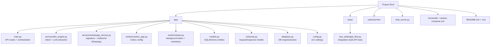
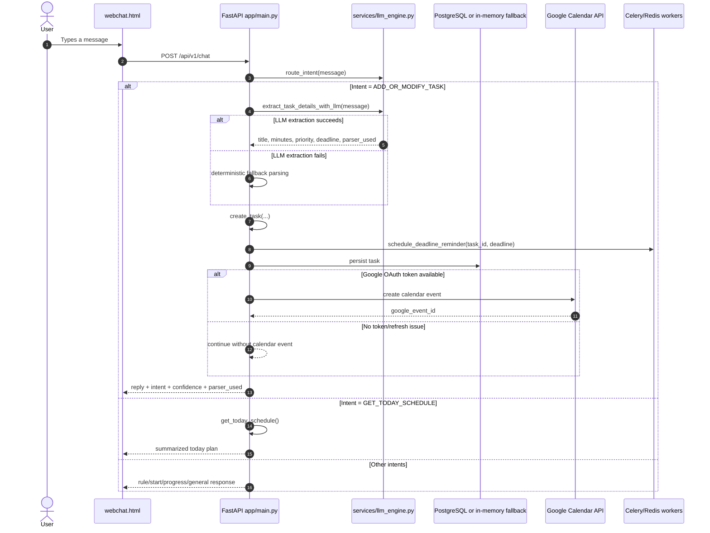
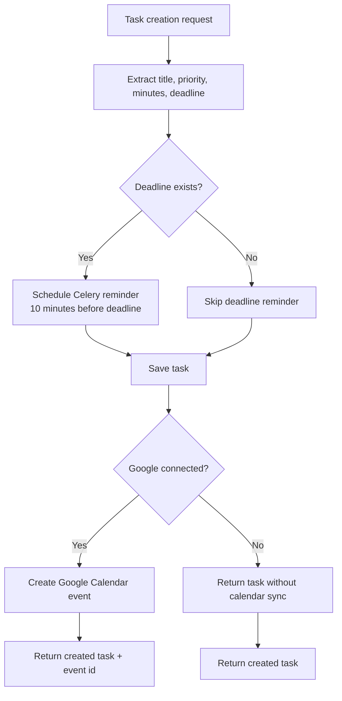
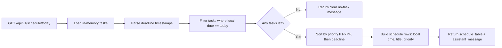

# Personal AI Assistant Workflow Map

This document explains how the current product works end to end, mapped by folder, runtime logic, and user-to-output flow.

## 1) Folder-to-Responsibility Map

## 2) User Interaction Flow (Web Chat to Output)

## 3) Task and Reminder Logic Flow

## 4) Schedule (Today) Logic

## 5) Current Output Paths You Can Expect

- Task-creation message:
  - Output includes task confirmation, estimated minutes, priority, optional schedule time.
  - Output also includes parser_used (gemini/openai/fallback/none) in API JSON.
- Schedule message:
  - Output includes a concise today plan summary from filtered today tasks.
- Calendar sync:
  - If connected, task can sync to Google Calendar.
  - If not connected, task still gets created and user gets reconnect hint.
- Reminders:
  - Deadline reminder is scheduled in Celery for tasks with future deadlines.

## 6) What Is Ready vs Next

Ready now:
- Chat-based task creation
- Intent routing with fallback parsing
- Today schedule filtering and prioritization
- Google Calendar create-on-task flow
- Deadline reminder scheduling
- Regression tests for major flows

Still to add in upcoming phases:
- Task update/delete endpoints in chat and API
- Calendar update/delete synchronization
- Reminder delivery channel output (for example WhatsApp push or in-app notification)
- Persistent planner history and richer daily planning heuristics
